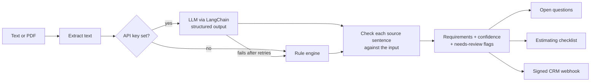

# Requirement & Scoping Tool

[](https://github.com/ruttvajkhodaskar/requirement-scoping-tool/actions)


A FastAPI service that reads a **customer call transcript or an RFP (text or PDF)** and gives the estimating team:

- a list of requirements (dimensions, material, quantity, timeline, budget, standards)
- the **exact source sentence** for each one, plus a confidence score
- a **needs review** flag when the tool is unsure
- a list of **open questions** (what the customer still has to tell us)
- a ready **estimating checklist**
- an optional **signed webhook** to push the notes into a CRM

> Demo project. All sample data is made up. No company data or code is inside.

**Live demo:** https://requirement-scoping-tool.onrender.com/

## The problem

After a discovery call or an RFP, someone must turn messy notes into a scope that the estimating team can price. When this is done by hand, details get lost, each rep writes it differently, and the estimator has to come back to the customer with questions that could have been asked on the first call.

This tool makes the handoff the same every time, and shows what is **missing** before the estimator starts.

## How it works



Key design choices:

| Choice | Why |
|---|---|
| **Source sentence for every item** | The estimator can check any number in one glance. |
| **Source is checked against the input** | If the LLM quotes a sentence that is not in the text, the item is flagged. This catches made-up requirements. |
| **Confidence + needs-review flag** | A keyword like "budget" with no figure is not treated as a budget. It is marked unclear and becomes an open question. |
| **Rule mode and LLM mode** | The project runs and is testable with no API key. If the LLM fails after retries, the service falls back to rules and says so in `mode`. |
| **Works with OpenAI-compatible APIs** | Set `OPENAI_BASE_URL` to use another provider. |
| **HMAC-signed webhook with retries** | The CRM can verify the sender. Server errors are retried, client errors are not. |

## Quick start

```bash
python -m venv .venv
source .venv/bin/activate          # Windows: .venv\Scripts\activate
pip install -r requirements-dev.txt
cp .env.example .env               # optional: add an API key
uvicorn app.main:app --reload
```

- Web page: http://127.0.0.1:8000
- API docs: http://127.0.0.1:8000/docs

Try the sample PDF:

```bash
curl -X POST http://127.0.0.1:8000/extract-pdf -F "file=@samples/sample_rfp.pdf"
```

Or send text:

```bash
curl -X POST http://127.0.0.1:8000/extract \
  -H "Content-Type: application/json" \
  -d '{"text": "We need 500 pieces in stainless steel, 120 mm diameter, delivery in 8 weeks.", "customer": "Acme"}'
```

Note: environment variables are read from the shell. To load `.env` automatically, start with `uvicorn app.main:app --env-file .env`.

## API

| Method | Path | What it does |
|---|---|---|
| GET | `/` | Small web page for trying the tool |
| GET | `/health` | Status and version |
| POST | `/extract` | JSON body: `text`, optional `customer`, `send_to_crm` |
| POST | `/extract-pdf` | Form upload: `file` (PDF, max 10 MB), optional `customer`, `send_to_crm` |

Example item in the response:

```json
{
  "category": "Timeline",
  "detail": "Delivery within 10 weeks of the purchase order.",
  "source_sentence": "Delivery within 10 weeks of the purchase order.",
  "confidence": 0.85,
  "needs_review": false
}
```

## How good is it?

`eval/` has 20 made-up cases (transcripts, RFP bullets, messy one-liners, mixed language) with the correct answers. Run it with `python -m eval.run_eval`. Rule mode, **auto-accepted items** (items not flagged for review):

| Category | Precision | Recall | F1 | TP | FP | FN |
|---|---|---|---|---|---|---|
| Dimensions | 1.00 | 1.00 | 1.00 | 9 | 0 | 0 |
| Material | 1.00 | 1.00 | 1.00 | 19 | 0 | 0 |
| Quantity | 1.00 | 0.94 | 0.97 | 15 | 0 | 1 |
| Timeline | 0.92 | 0.92 | 0.92 | 11 | 1 | 1 |
| Budget | 1.00 | 0.80 | 0.89 | 4 | 0 | 1 |
| Standards | 0.71 | 0.83 | 0.77 | 5 | 2 | 1 |
| **All (micro)** | **0.95** | **0.94** | **0.95** | 63 | 3 | 4 |

Items flagged for review: 4 of 75.

Please read these numbers with care:

- The 20 cases were **written by the same person who wrote the rules**, so the scores are optimistic. Treat them as a regression check, not as a promise for real customer data.
- Some cases are traps on purpose, such as a customer's own ISO certificate, a past order, and the steel grade "EN24". These are where rule mode makes mistakes.
- The check is at category level: did we find the right value for each category. It does not yet check every item in a sentence.
- LLM mode can be scored with the same script (`python -m eval.run_eval --mode llm`). Run it with your key and put your numbers here.

CI runs the tests and fails if the rule-mode F1 drops below 0.85.

## Known limits

- Rule mode is keyword matching. It misses vague phrases ("before the festival season") and amounts written in words ("forty thousand dollars"). It can also match a customer's own details, such as their ISO certificate, as a requirement.
- Scanned PDFs are rejected with a clear message. OCR is not included.
- Tables inside PDFs may be read in a mixed order, because only plain text is extracted.
- Text is limited to 50,000 characters per request. Nothing is stored. Every request is handled in memory.
- There is no login on the API. Put it behind a gateway or add authentication before real use.

## Configuration

| Variable | Meaning |
|---|---|
| `OPENAI_API_KEY` | Turns on LLM mode. Empty means rule mode. |
| `OPENAI_BASE_URL` | Optional. For OpenAI-compatible providers. |
| `LLM_MODEL` | Model name. Default `gpt-4o-mini`. |
| `LLM_MAX_RETRIES` | Extra attempts when the LLM call fails. Default 2. |
| `CRM_WEBHOOK_URL` | Where to send the notes. Empty means skipped. |
| `CRM_WEBHOOK_SECRET` | If set, adds an `X-Signature` header (SHA-256 HMAC of the body). |
| `LOG_LEVEL` | Default `INFO`. |

To verify a webhook on the receiving side:

```python
import hmac, hashlib
expected = hmac.new(SECRET.encode(), raw_body, hashlib.sha256).hexdigest()
ok = hmac.compare_digest(expected, request_headers["X-Signature"])
```

## Tests, Docker, deploy

```bash
pytest -q                          # 23 tests: rules, grounding, retries, PDF, webhook, API
python -m eval.run_eval --write    # quality report
docker build -t scoping-tool . && docker run -p 8000:8000 --env-file .env scoping-tool
```

Deploy guide for Render (free) and Azure Container Apps: [docs/DEPLOY.md](docs/DEPLOY.md).

## Project layout

```
app/
  main.py        routes, logging, request limits
  extractor.py   rule mode, LLM mode, retries, source check
  pdf.py         PDF text extraction with clear errors
  checklist.py   markdown checklist
  webhook.py     signed CRM webhook with retries
  schemas.py     Pydantic models
  static/        small web page
eval/            labelled cases and scoring script
tests/           pytest tests
samples/         made-up transcript, RFP text and RFP PDF
docs/DEPLOY.md   deploy steps
```

## What I would add next

- Score LLM mode on a larger set of real (anonymised) documents
- OCR for scanned PDFs
- Item-level scoring in the eval, not only category-level
- API-key authentication and rate limiting
- A review screen where the estimator can correct an item and the correction is saved for later evaluation

## Tech

Python, FastAPI, Pydantic, LangChain, pypdf, httpx, pytest, Docker, GitHub Actions
